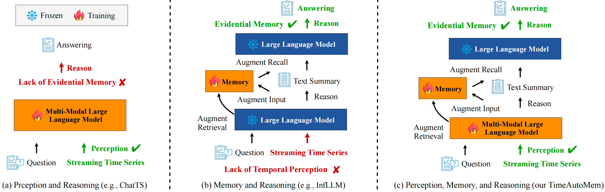

# TimeAutoMem: Pattern-Aware Autonomous Memory for Streaming Time Series Question Answering

[](https://github.com/Leeway-95/TimeAutoMem/stargazers)


<!--
[](#citation)
-->

✨ If you find our work useful for your research, please consider giving it a <strong>star ⭐ on GitHub</strong> to stay updated with future releases.


<!--
 
-->

<!--
[[🧰 **Training Scripts**]](https://github.com/xiezhe-24/ChatTS-Training) ·
[[📚 **Training Datasets**]](https://huggingface.co/datasets/ChatTSRepo/ChatTS-Training-Dataset) ·
[[🧪 **Evaluation Datasets**]](https://doi.org/10.5281/zenodo.14349206)

[](https://huggingface.co/Leeway2027/Qwen3-TSVL-4B)
[](https://doi.org/10.5281/zenodo.14349206)


-->

<!--[](https://huggingface.co/spaces/Leeway2027/Qwen3-TSVL-4B)-->

<!--
This repository provides the code for our paper.
>  ✨ If you find our work useful for your research, please consider giving it a <strong>star ⭐ on GitHub</strong> to stay updated with future releases.
-->
<!--
## Demonstration
https://github.com/user-attachments/assets/5ae6cd92-19d5-43d1-855b-3d2670bce14f
-->

<!--
## Key Features
TimeAutoMem can be directly applied to any LLMs without retraining:
- ✅ **Native support for multivariate time series**
-->

## Abstract

Streaming time series evolve continuously, depending on complete coverage, including historical memory and current observations.

Existing Time Series Question Answering (TSQA) methods primarily target static time-series segments yet lack dynamic memory beyond the context windows of Large Language Models (LLMs).

This limitation is particularly critical in monitoring systems, such as database AIOps, posing two fundamental challenges from the data and model perspective: (1) autonomous temporal perception and (2) memory-augmented reasoning.

To address these challenges, we propose **TimeAutoMem**,  a streaming **Time** series question answering framework with pattern-aware **Auto**nomous **Mem**ory. Specifically, TimeAutoMem consists of two stages: (a) The Perception stage enables low-cost streaming perception using a lightweight time-series LLM, detects temporal intent from user questions, and autonomously retrieves temporal memory; and (b) the Reasoning stage leverages retrieved temporal evidence and reasoning policies to perform high-quality TSQA with a powerful LLM.

We further introduce **STREAMTSPC-109K**, a streaming TSQA benchmark spanning 13 scenarios and comprising 109,498 question episodes across millions of data points, with textual clues aligned to temporal patterns.

Extensive experiments on real-world datasets demonstrate that TimeAutoMem consistently outperforms advanced methods in accuracy while substantially reducing costs over diverse scenarios.
<br><br>
<p align="left">

<p>

Comparison of three TSQA paradigms. (a) perception and reasoning paradigm lacks evidential memory (e.g., ChatTS). (b) memory and reasoning paradigm lacks temporal perception (e.g., InfLLM). (c) perception, memory and reasoning paradigm have both temporal perception for streaming time series and reasoning with evidential memory (e.g., our TimeAutoMem).

## [🌐 **Web Demo**](http://cdblp.ruc-wamdm.cn/AsTimeQA)
We implemented a streaming TSQA [System Demo](http://cdblp.ruc-wamdm.cn/AsTimeQA) with [🤗 Qwen3-TSVL-4B](https://huggingface.co/Leeway2027/Qwen3-TSVL-4B) for streaming time series perception.

## Dependencies
* Python 3.12
* numpy==1.26.4
* numba==0.61.0
* pandas==2.3.1
* apache-flink==2.1.0

```bash
> conda env create -f env_linux.yaml
```
<!--
## Datasets
1. Understanding task dataset can be downloaded from [TSQA](https://huggingface.co/datasets/ChengsenWang/TSQA).
2. Reasoning task datasets can be downloaded from [Oracle](https://zenodo.org/records/6955909), [AIOps](https://github.com/netmanaiops/kpi-anomaly-detection), [WeatherQA](https://www.bgc-jena.mpg.de/wetter), [NAB](https://github.com/numenta/NAB), and [MCQ2](https://github.com/behavioral-data/TSandLanguage).
3. Prediction task datasets can be downloaded from [Weather](https://github.com/geon0325/TimeCAP/tree/main/dataset/weather), [Finance](https://github.com/geon0325/TimeCAP/tree/main/dataset/finance), and [Healthcare](https://github.com/geon0325/TimeCAP/tree/main/dataset/healthcare).
-->
## Usages

* ### Obtain TimeAutoMem

```bash
git clone https://github.com/Leeway-95/TimeAutoMem.git
cd TimeAutoMem
pip3 install -r requirements.txt
```

* ### Batch version

```bash
sh scripts/batch_run.sh
```

* ### Stream version
   
```bash
sh scripts/stream_run.sh
```
<!--
## Contact Us
For inquiries or further assistance, contact us at [leeway@ruc.edu.cn](mailto:leeway@ruc.edu.cn).
-->
